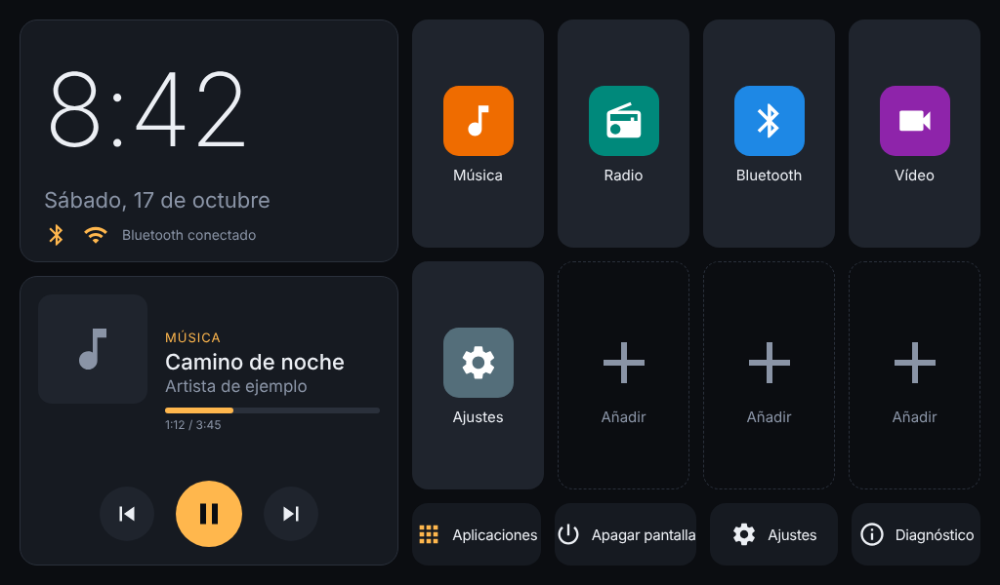
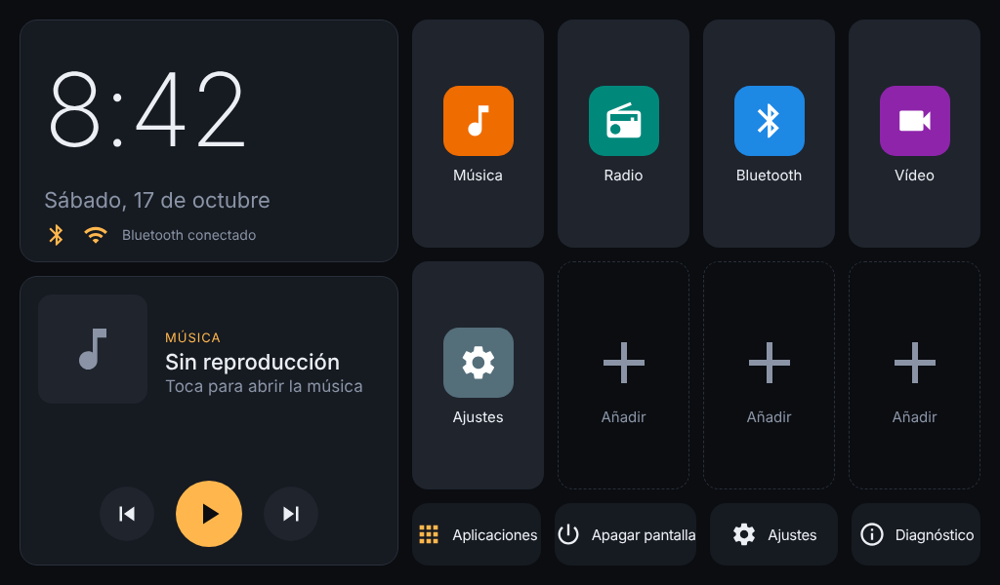
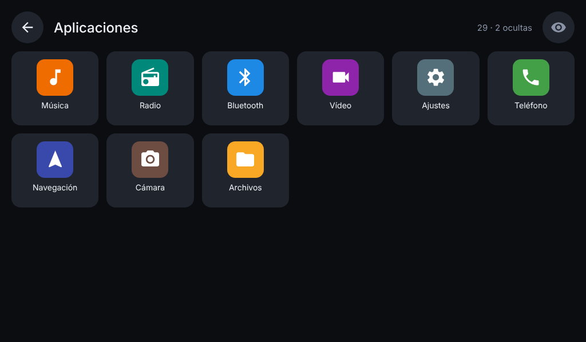
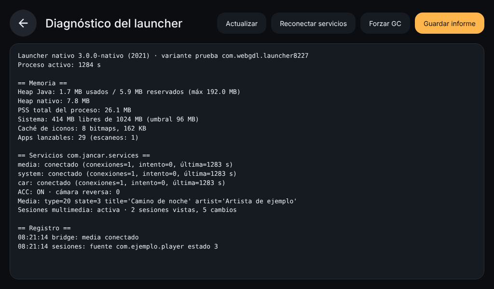

# Launcher nativo para autoestéreos Android «Jancar» (alps 8227L · JCAC10003)

[](https://github.com/web-gdl/Laucher_8227L_JCAC10003/actions/workflows/main.yml)
[](LICENSE)

Un launcher (pantalla de inicio) **ligero, estable y 100 % nativo** para los autoestéreos Android baratos con el
chip MediaTek **AC8227L** y el software de Jancar, como el **JCAC10003**: 1 GB de RAM, pantalla de 1024×600.
Sustituye al launcher de fábrica sin skins ni temas, usa unos 26 MB de memoria y se entiende con los servicios
del estéreo (música, volante, ACC, cámara de reversa) sin necesitar ningún SDK del fabricante.

> **Es un regalo para quien lo quiera usar.** Dominio público: cópialo, modifícalo, véndelo, mejóralo. Sin permiso, sin atribución.

<p align="center">
  
  
</p>
<p align="center">
  
  
</p>

> Las imágenes son un **render del diseño** a 1024×600 con datos de ejemplo (mismo layout, colores, medidas y vectores
> que `res/`), no capturas del equipo ni los iconos reales de tus apps. Se regeneran con
> [`docs/preview/render.py`](docs/preview/render.py). ¿Tienes capturas reales de tu estéreo? Se aceptan con gusto.

---

## Descargar

| Archivo | Para qué sirve |
|---|---|
| **[launcher-prueba.apk](https://github.com/web-gdl/Laucher_8227L_JCAC10003/releases/latest/download/launcher-prueba.apk)** | **Empieza por aquí.** Se instala como una app normal y convive con el launcher de fábrica. Se quita como cualquier app. |
| [launcher-reemplazo.apk](https://github.com/web-gdl/Laucher_8227L_JCAC10003/releases/latest/download/launcher-reemplazo.apk) | Sustituye al launcher de fábrica (necesita `adb`). Hereda privilegios de sistema. Solo para quien sepa revertirlo. |
| [SHA256SUMS.txt](https://github.com/web-gdl/Laucher_8227L_JCAC10003/releases/latest/download/SHA256SUMS.txt) | Sumas de verificación de los APK. |

Todas las versiones: [Releases](https://github.com/web-gdl/Laucher_8227L_JCAC10003/releases).
Cada APK se compila en GitHub Actions a partir de este código; puedes compilarlo tú mismo (ver más abajo).

## Instalación de la versión de prueba

1. Copia `launcher-prueba.apk` al estéreo (memoria USB) y ábrelo con un explorador de archivos; permite «instalar apps desconocidas» si lo pide.
   También sirve `adb install launcher-prueba.apk`.
2. Aparece como **«Inicio (prueba)»**. Pulsa el botón **Inicio** del estéreo y, cuando pregunte qué launcher usar, elige *Inicio (prueba)* → **«Solo una vez»**.
3. Con «Solo una vez», la próxima vez que pulses Inicio el estéreo te vuelve a preguntar, así que siempre puedes elegir el launcher de fábrica. Para quitarlo, desinstálalo como cualquier app.

La versión de prueba no toca nada del sistema: no es persistente, no usa el usuario de sistema y no pide a la «app de memoria» que arranque con el coche.

## Instalación de la versión de reemplazo (avanzado)

Usa el mismo paquete (`com.android.launcher3`) y la firma de plataforma que el de fábrica, así que se instala **como actualización**:

```
adb install -r launcher-reemplazo.apk
adb uninstall com.android.launcher3     # revertir (vuelve el launcher de fábrica si estaba en /system)
```

Con ella el estéreo vuelve a abrir la última app de música unos segundos después de arrancar, igual que el launcher de fábrica.
Si no estás seguro de poder revertirla, **no la instales**: usa la de prueba.

## Qué hace

- **Inicio** de una sola pantalla: reloj y fecha, estado de Bluetooth y Wi‑Fi, tarjeta de música, 8 favoritos (4×2) y barra inferior.
- **Tarjeta de música** con título, artista, portada, progreso y anterior / play‑pausa / siguiente. Funciona con las fuentes de fábrica (música, radio,
  vídeo, Bluetooth) y con **apps de terceros**: para estas obtiene el paquete, el estado y la posición de la sesión multimedia de Android, de modo que
  al tocar la tarjeta se abre la app que está sonando. Pulsación larga para elegir la app de música por defecto.
- **Todas las aplicaciones** en una vista superpuesta (6 columnas), con menú contextual: añadir/quitar favoritos, ocultar, información de la app y desinstalar.
- **Apagar pantalla** con la misma llamada que usa el launcher de fábrica.
- **Diagnóstico**: memoria, estado de los enlaces con el servicio del estéreo, ACC (tres fuentes para contrastarlas), cámara de reversa, sesiones multimedia y
  registro de eventos. Se puede guardar como informe de texto. Si el launcher se cierra, deja `files/crash.txt` con la pila.
- Idiomas: español e inglés.

### Por qué es ligero

- Una sola `Activity`; el panel de apps es una vista superpuesta, sin segunda pantalla ni animaciones.
- Java sin Kotlin ni librerías de soporte (el APK pesa unos 80 KB).
- Iconos rasterizados al tamaño de la celda en una caché de 3 MB con un único hilo de fondo; una sola portada viva.
- Casi sin sondeo: el reloj usa `TIME_TICK`, Bluetooth y Wi‑Fi usan *broadcasts* y callbacks, y la música se actualiza por avisos del servicio.
  Todo se registra al mostrarse la pantalla y se da de baja al salir. La única excepción es un refresco de 1 s de la barra de progreso de apps de terceros,
  y solo mientras suena algo y el inicio está visible.
- Medido en un JCAC10003: **PSS ≈ 26 MB**, heap Java ≈ 1,7 MB, 29 apps escaneadas en ≈ 0,2 s.

## Cómo se integra con el estéreo

El software de Jancar expone el servicio `com.jancar.services` (AIDL por binder) sin exigir permisos a quien se conecta.
El launcher incluye un cliente binder propio, [`JancarBridge`](src/com/android/launcher3/jancar/JancarBridge.java), que se obtiene de analizar
estáticamente las apps de fábrica, sin ejecutarlas:

| Servicio | Para qué se usa |
|---|---|
| `IMedia` | Recibir título, artista, portada y estado de la fuente activa; play‑pausa, anterior y siguiente. |
| `ISystem` | Apagar la retroiluminación; pedir la «app de memoria» al arrancar (solo variante de reemplazo). |
| `ICar` | Estado del ACC y de la cámara de reversa. |

Se reconecta solo con `linkToDeath` y reintentos escalonados (1, 2, 5, 10 y 30 s). Los códigos de transacción salen de los stubs AIDL de
`ivi-launcher 2.0` y `com.jancar.services 3.0.0`; **otras versiones del firmware podrían cambiarlos**. Para apps de terceros (fuente tipo 20) se complementa con
`MediaSessionManager`, que requiere el permiso de firma `MEDIA_CONTENT_CONTROL`; si no se concede, el launcher sigue funcionando solo con el servicio.

## Compatibilidad

- **Probado por el autor en un único equipo**: JCAC10003 (alps 8227L), 1024×600. Las medidas del diseño asumen esa pantalla.
- Requiere Android 8.0 o superior (API 26); compilado contra la API 27.
- Otros estéreos con `com.jancar.services` (chips «ac8227l_8229» y similares) podrían funcionar; si lo pruebas, abre un *issue* con el informe de Diagnóstico.
- Sin `com.jancar.services` el launcher arranca igual, pero la tarjeta de música muestra «Servicio del estéreo no disponible».

## Compilar

Sin Gradle ni Android Studio. Necesitas JDK 17+, Python 3, `curl` y `unzip`.

```
./tools/get-tools.sh              # android.jar 27, aapt2, jadx/D8/apksig y claves de plataforma AOSP
./build.sh --variant prueba       # out/launcher-prueba.apk
./build.sh --variant reemplazo    # out/launcher-nativo.apk
./build.sh --variant ambas
```

La cadena es `aapt2` → `javac --release 8` → `D8` → zip → firma v1+v2 (`apksig`) → verificación. Cada push a `main` compila las dos variantes
(artefactos de *Actions*) y cada etiqueta `v*` publica una *Release* con los APK ([`release.yml`](.github/workflows/release.yml)).

### Estructura

```
AndroidManifest.xml
src/com/android/launcher3/
  HomeActivity.java         única pantalla: inicio + panel de apps superpuesto
  AppsRepository.java       lista de apps y caché de iconos (hilo de fondo)
  jancar/JancarBridge.java  cliente binder de com.jancar.services
  media/SessionProbe.java   sesiones multimedia de Android para fuentes de terceros
  ui/                       reloj, estado de Bluetooth/Wi-Fi, tarjeta de música
  DiagnosticsActivity.java  informe de memoria, servicios y registro
res/                        layouts, vectores y textos (es/en)
tools/                      get-tools.sh, Sign.java, Verify.java
docs/                       capturas y su generador
```

## Seguridad: léelo antes de instalar

- Los APK se firman con la **clave de plataforma de prueba de AOSP**, que es **pública**. Es lo que permite instalarlos como actualización del launcher de fábrica
  en estos equipos, pero significa que **cualquiera podría firmar otro APK con la misma clave**. Instala solo APK de este repositorio y comprueba las sumas
  de `SHA256SUMS.txt`. No uses esta clave para nada que importe fuera de este estéreo.
- La variante de reemplazo corre con el usuario de sistema (`android.uid.system`). Un fallo ahí tiene más alcance que en una app normal.
- El software se ofrece **«tal cual», sin garantía**. Instalar un launcher alternativo en un estéreo de coche es bajo tu responsabilidad.

## Contribuir

Todo es bienvenido: capturas reales, informes de Diagnóstico de otros equipos, correcciones, traducciones. Abre un *issue* o un *pull request*.

## Licencia

[The Unlicense](LICENSE): dominio público. Consulta <https://unlicense.org>.

---

## English summary

A lightweight, fully native home-screen (launcher) for cheap Jancar/alps **AC8227L** Android car head units such as the **JCAC10003** (1 GB RAM, 1024×600).
It replaces the factory launcher with a single-activity, ~80 KB, ~26 MB-PSS app that talks to the head unit's `com.jancar.services` (music, ACC, reverse camera, screen-off)
through its own binder client. Third-party music apps are supported through Android media sessions.

**Download:** [`launcher-prueba.apk`](https://github.com/web-gdl/Laucher_8227L_JCAC10003/releases/latest/download/launcher-prueba.apk) (installs like a normal app, safe to try) ·
[`launcher-reemplazo.apk`](https://github.com/web-gdl/Laucher_8227L_JCAC10003/releases/latest/download/launcher-reemplazo.apk) (replaces the factory launcher, needs `adb`).
Tested only on one JCAC10003. APKs are signed with the public AOSP platform test key (see *Seguridad*). Public domain (Unlicense); provided as is, with no warranty.
