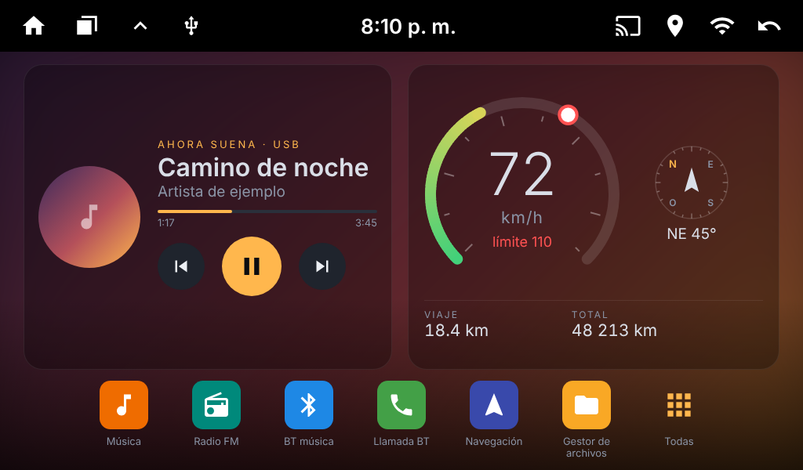
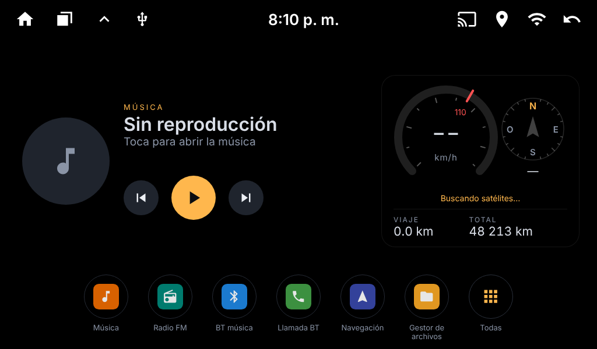
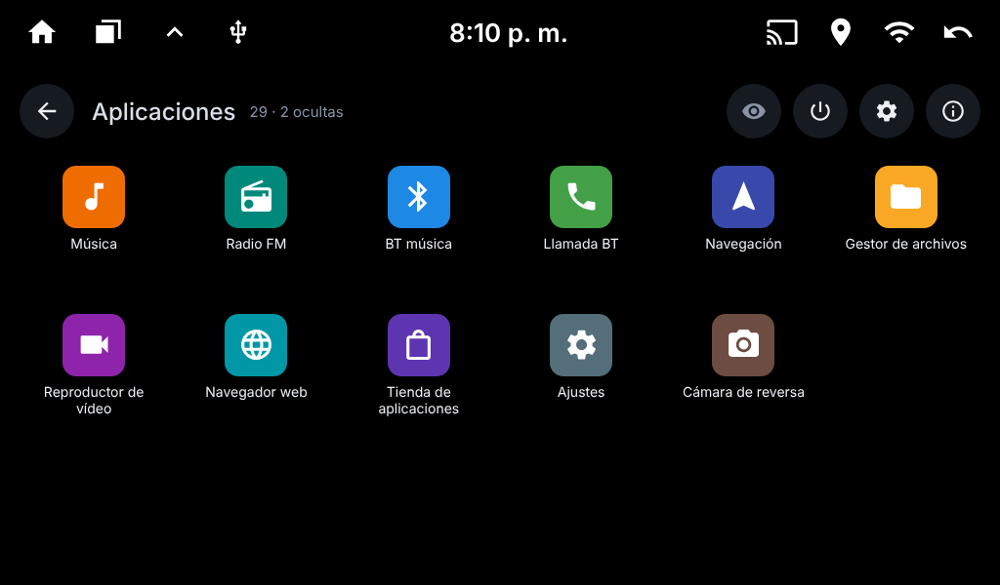
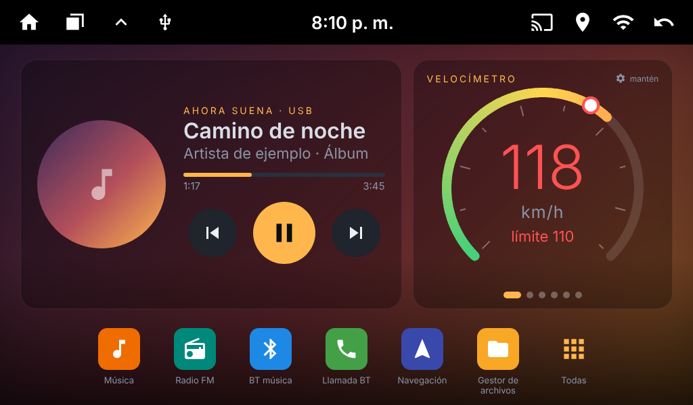
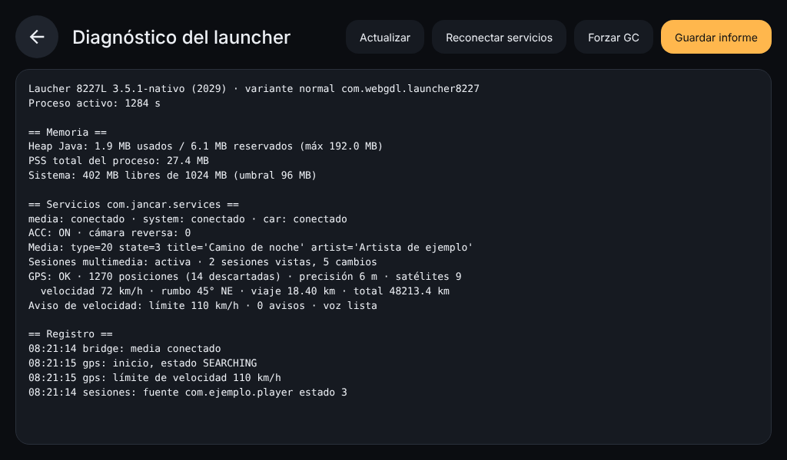

# Laucher 8227L: launcher nativo para autoestéreos Android «Jancar» (alps 8227L · JCAC10003)

[](https://github.com/web-gdl/Laucher_8227L_JCAC10003/actions/workflows/main.yml)
[](LICENSE)

Un launcher (pantalla de inicio) **ligero, estable y 100 % nativo** para los autoestéreos Android baratos con el
chip MediaTek **AC8227L** y el software de Jancar, como el **JCAC10003**: 1 GB de RAM, pantalla de 1024×600.
Sustituye al launcher de fábrica sin skins ni temas, usa unos 26 MB de memoria y se entiende con los servicios
del estéreo (música, volante, ACC, cámara de reversa) sin necesitar ningún SDK del fabricante. Desde la 3.5 muestra
**velocidad, brújula y odómetro** con el GPS del estéreo, con **aviso de voz** al pasar el límite de velocidad que elijas.

> **Es un regalo para quien lo quiera usar.** Dominio público: cópialo, modifícalo, véndelo, mejóralo. Sin permiso, sin atribución.

<p align="center">
  
  
</p>
<p align="center">
  
  
</p>
<p align="center">
  
</p>

> Las imágenes son un **render del diseño** a 1024×600 con datos de ejemplo (mismo layout, colores, medidas y vectores
> que `res/`), no capturas del equipo ni los iconos reales de tus apps. La barra superior es la del sistema del estéreo,
> no la dibuja el launcher. Se regeneran con [`docs/preview/instrumentos.py`](docs/preview/instrumentos.py), [`docs/preview/nocturno.py`](docs/preview/nocturno.py) y
> [`docs/preview/render.py`](docs/preview/render.py). ¿Tienes capturas reales de tu estéreo? Se aceptan con gusto.

## Estado del proyecto

**Versión estable: 3.5.3** (noviembre de 2026), con velocímetro, brújula, odómetro y aviso de límite de velocidad; ver [`CHANGELOG.md`](CHANGELOG.md).
**Probada por el autor en su JCAC10003** (12-nov-2026) con la variante normal (`Laucher-8227L.apk`): abre bien y el velocímetro y la brújula funcionan.
Las versiones 3.5.0–3.5.2 no abrían en este equipo: no las uses.

- ✅ Inicio nocturno con música e instrumentos, dock de favoritos y panel de aplicaciones sin recuadros.
- ✅ Widget de música con apps de terceros (RadilloPlayerWave) y fondo con los colores de la portada.
- ✅ La música vuelve al encender el auto (el estéreo despierta, no reinicia).
- ✅ Velocímetro y brújula con el GPS del estéreo, confirmados en el equipo con la 3.5.3.
- ⏳ Odómetro y aviso de voz del límite: publicados y con pruebas automáticas (recorridos simulados y arranque en emulador en cada
  cambio); falta la confirmación en carretera.
- ⏳ Variante de reemplazo (`com.android.launcher3`): compila y es la misma base, pero el autor no la ha instalado.
- ⏳ Consumo de memoria: el informe de Diagnóstico ya muestra el desglose; queda medirlo en el equipo para recortar lo que haga falta.

**Límites conocidos**

- Al apagar el auto, el servicio del estéreo cierra la variante normal (no está en su lista de paquetes protegidos);
  al encender se vuelve a abrir sola como pantalla de inicio. La de reemplazo no tiene ese problema.
- Los códigos del servicio `com.jancar.services` salen del firmware de este equipo; otro firmware podría cambiarlos.
- El estéreo no lee los datos del auto (no tiene OBD): velocidad, rumbo y kilómetros salen de **su GPS**. El «Total» cuenta
  desde que instalas la 3.5; ajústalo una vez al número del tablero. La brújula solo sabe el rumbo en movimiento.
- Las imágenes del README son renders del diseño, no capturas.

El historial completo está en [`CHANGELOG.md`](CHANGELOG.md). El diseño se eligió entre 20 propuestas, que están en [`docs/bocetos/`](docs/bocetos/).

---

## Descargar

| Archivo | Para qué sirve |
|---|---|
| **[Laucher-8227L.apk](https://github.com/web-gdl/Laucher_8227L_JCAC10003/releases/latest/download/Laucher-8227L.apk)** | **La versión para instalar.** Se instala como una app normal y convive con el launcher de fábrica. Se quita como cualquier app. |
| [Laucher-8227L-reemplazo.apk](https://github.com/web-gdl/Laucher_8227L_JCAC10003/releases/latest/download/Laucher-8227L-reemplazo.apk) | Sustituye al launcher de fábrica (necesita `adb`). Hereda privilegios de sistema. Solo para quien sepa revertirlo. |
| [SHA256SUMS.txt](https://github.com/web-gdl/Laucher_8227L_JCAC10003/releases/latest/download/SHA256SUMS.txt) | Sumas de verificación de los APK. |

Todas las versiones: [Releases](https://github.com/web-gdl/Laucher_8227L_JCAC10003/releases).
Cada APK se compila en GitHub Actions a partir de este código; puedes compilarlo tú mismo (ver más abajo).

## Instalación

1. Copia `Laucher-8227L.apk` al estéreo (memoria USB) y ábrelo con un explorador de archivos; permite «instalar apps desconocidas» si lo pide.
   También sirve `adb install -r Laucher-8227L.apk`. Si ya tenías una versión anterior («Inicio (prueba)»), se instala encima y conserva tus favoritos.
2. Aparece como **«Laucher 8227L»**. Pulsa el botón **Inicio** del estéreo y, cuando pregunte qué launcher usar, elige *Laucher 8227L* →
   **«Siempre»** para dejarlo como pantalla de inicio (o «Solo una vez» si quieres seguir eligiendo).
3. El velocímetro y el odómetro empiezan apagados: **toca la tarjeta de instrumentos** («Toca para activar velocímetro y odómetro») y concede el permiso de ubicación.
   Después toca *Total* → *Ajustar total* y escribe los km del tablero, y toca el velocímetro para fijar tu límite de velocidad.
4. Para volver al de fábrica: Ajustes → Aplicaciones → Laucher 8227L → *Borrar valores predeterminados*, o desinstálalo como cualquier app.

Esta variante no toca nada del sistema: no es persistente, no usa el usuario de sistema y no pide a la «app de memoria» que arranque con el coche.

**Si el inicio no abre** (pantalla «Abrir con… una vez / siempre» que no avanza): pasaba con la 3.5.0–3.5.2 en el 8227L; la 3.5.3 ya no toca el GPS al abrir
y, si el GPS del estéreo se cuelga, lo avisa en la tarjeta en vez de congelarse (ese GPS a veces solo se recupera con el botón RESET).
Para salir: botón *Atrás* o *Inicio* de la barra del sistema y elige el launcher de fábrica; si elegiste «Siempre», entra en
Ajustes → Aplicaciones → Laucher 8227L → *Borrar valores predeterminados* (o `adb uninstall com.webgdl.launcher8227`) e instala la 3.5.3.
Si el launcher se cierra solo, deja `Android/data/com.webgdl.launcher8227/files/crash.txt` en la memoria del estéreo: adjúntalo en un *issue*.

## Instalación de la versión de reemplazo (avanzado)

Usa el mismo paquete (`com.android.launcher3`) y la firma de plataforma que el de fábrica, así que se instala **como actualización**:

```
adb install -r Laucher-8227L-reemplazo.apk
adb uninstall com.android.launcher3     # revertir (vuelve el launcher de fábrica si estaba en /system)
```

Con ella el estéreo vuelve a abrir la última app de música unos segundos después de arrancar, igual que el launcher de fábrica.
Si no estás seguro de poder revertirla, **no la instales**: usa `Laucher-8227L.apk`.

## Qué hace

- **Inicio** de una sola pantalla: la música a la izquierda, los instrumentos a la derecha y un dock con 6 favoritos y «Todas». La hora y el estado los da la barra del sistema.
- **Velocímetro** de arco (0–180 km/h) con degradado verde → amarillo → rojo, **brújula** con el rumbo (N, NE, E… y grados) y
  **odómetro** de viaje y total, todo con el GPS del estéreo (1 posición por segundo):
  - **Límite de velocidad**: toca el velocímetro y escribe los km/h (por ejemplo 110). Aparece una marca roja en el arco y, si lo pasas
    más de 2 s, una voz dice «Está excediendo el límite de velocidad» (se repite cada 30 s mientras sigas por encima; sin voz instalada, suena un pitido).
    El número se pone rojo. «Desactivar» lo quita.
  - **Odómetro**: tócalo para *Reiniciar viaje a 0*, *Ajustar viaje* o *Ajustar total* (al número del tablero del auto). Atajos: pulsación larga en Viaje para reiniciarlo, en Total para ajustarlo.
  - Se descartan posiciones imprecisas, el «baile» del GPS con el auto parado y los saltos imposibles. Se mide solo con el auto encendido; una notificación
    silenciosa «Odómetro» mantiene el GPS activo aunque tengas otra app delante. Empiezan apagados: se activan tocando la tarjeta (y se apagan desde el menú del odómetro).
- **Música** con título, artista, portada redonda, fondo con sus colores, progreso, tiempos y anterior / play‑pausa / siguiente. Funciona con las fuentes de fábrica (música, radio,
  vídeo, Bluetooth) y con **apps de terceros**: para estas obtiene el paquete, el estado y la posición de la sesión multimedia de Android, de modo que
  al tocar la portada o el título se abre la app que está sonando. Pulsación larga para elegir la app de música por defecto.
- **Todas las aplicaciones** en una vista superpuesta (6 columnas), con menú contextual: añadir/quitar favoritos, ocultar, información de la app y desinstalar.
  En su cabecera: mostrar ocultas, apagar pantalla, ajustes y diagnóstico. Pulsación larga en un favorito del dock para quitarlo.
- **La música vuelve al encender el auto**: se recuerda la última canción y su app; al arrancar o despertar el estéreo,
  la app de memoria recibe el aviso de la llave (o se abre con `boot_memory=true`) y sigue donde iba. Si no hay fuente,
  el widget muestra «Última canción · toca ▶ para seguir».
- **Apagar pantalla** con la misma llamada que usa el launcher de fábrica.
- **Diagnóstico**: memoria, estado de los enlaces con el servicio del estéreo, ACC (tres fuentes para contrastarlas), cámara de reversa, sesiones multimedia y
  registro de eventos. Se puede guardar como informe de texto. Si el launcher se cierra, deja `files/crash.txt` con la pila.
- Idiomas: español e inglés.

### Por qué es ligero

- Una sola `Activity`; el panel de apps es una vista superpuesta, sin segunda pantalla ni animaciones.
- Java sin Kotlin ni librerías de soporte (el APK pesa unos 80 KB).
- Iconos rasterizados al tamaño de la celda en una caché de 3 MB con un único hilo de fondo; una sola portada viva.
- El fondo de colores se calcula una vez por canción sobre un bitmap de 64×34 (≈9 KB) y no cuesta nada por fotograma.
- Casi sin sondeo: la música se actualiza por avisos del servicio y de la sesión multimedia; desde la 3.1.0 no hay reloj ni
  receptores de Bluetooth/Wi‑Fi propios (lo hace la barra del sistema). La única excepción es un refresco de 1 s de la barra de progreso de apps de terceros,
  y solo mientras suena algo y el inicio está visible.
- Medido en un JCAC10003: **PSS ≈ 26 MB** con la 3.0.0 recién abierta y ≈ 53 MB con la 3.3.0 tras un rato de uso; heap Java ≈ 2 MB.
  El desglose de Diagnóstico (3.3.2) dirá qué parte es memoria gráfica del sistema y qué parte se puede recortar.

## Cómo se integra con el estéreo

El software de Jancar expone el servicio `com.jancar.services` (AIDL por binder) sin exigir permisos a quien se conecta.
El launcher incluye un cliente binder propio, [`JancarBridge`](src/com/android/launcher3/jancar/JancarBridge.java), que se obtiene de analizar
estáticamente las apps de fábrica, sin ejecutarlas:

| Servicio | Para qué se usa |
|---|---|
| `IMedia` | Recibir título, artista, portada y estado de la fuente activa; play‑pausa, anterior y siguiente. |
| `ISystem` | Apagar la retroiluminación; saber cuál es la «app de memoria» y pedir que se abra al arrancar (variante de reemplazo). |
| `ICar` | Estado del ACC y de la cámara de reversa. |

Se reconecta solo con `linkToDeath` y reintentos escalonados (1, 2, 5, 10 y 30 s). Los códigos de transacción salen de los stubs AIDL de
`ivi-launcher 2.0` y `com.jancar.services 3.0.0`; **otras versiones del firmware podrían cambiarlos**. Para apps de terceros (fuente tipo 20) se complementa con
`MediaSessionManager`, que requiere el permiso de firma `MEDIA_CONTENT_CONTROL`; si no se concede, el launcher sigue funcionando solo con el servicio.

## Compatibilidad

- **Probado por el autor en un único equipo**: JCAC10003 (alps 8227L), 1024×600. Las medidas del diseño asumen esa pantalla.
- Requiere Android 8.0 o superior (API 26); compilado contra la API 27.
- Otros estéreos con `com.jancar.services` (chips «ac8227l_8229» y similares) podrían funcionar; si lo pruebas, abre un *issue* con el informe de Diagnóstico.
- Sin `com.jancar.services` el launcher arranca igual, pero la tarjeta de música muestra «Servicio del estéreo no disponible».

## Compilar

Sin Gradle ni Android Studio. Necesitas JDK 17+, Python 3, `curl` y `unzip`.

```
./tools/get-tools.sh              # android.jar 27, aapt2, jadx/D8/apksig y claves de plataforma AOSP
./build.sh --variant normal       # out/Laucher-8227L.apk
./build.sh --variant reemplazo    # out/Laucher-8227L-reemplazo.apk
./build.sh --variant ambas
```

La cadena es `aapt2` → `javac --release 8` → `D8` → zip → firma v1+v2 (`apksig`) → verificación. Cada push a `main` compila las dos variantes
(artefactos de *Actions*) y cada cambio de [`VERSION`](VERSION) (o etiqueta `v*`) publica una *Release* con los APK ([`release.yml`](.github/workflows/release.yml)).

### Estructura

```
AndroidManifest.xml
src/com/android/launcher3/
  HomeActivity.java         única pantalla: inicio + panel de apps superpuesto
  AppsRepository.java       lista de apps y caché de iconos (hilo de fondo)
  jancar/JancarBridge.java  cliente binder de com.jancar.services
  media/SessionProbe.java   sesiones multimedia de Android para fuentes de terceros
  ui/MediaWidget.java       música del inicio (portada, tiempos, fondo)
  ui/Backdrop.java          fondo con los colores de la portada (Java puro)
  ui/SpeedGaugeView.java    velocímetro de arco con degradado y marca del límite
  ui/CompassView.java       brújula (rosa que gira con el rumbo)
  car/Trip.java             velocidad, rumbo y odómetro a partir del GPS (Java puro, con pruebas)
  car/SpeedLimit.java       cuándo avisar por exceso de velocidad (Java puro, con pruebas)
  car/GpsTracker.java       LocationManager (en hilo propio, con vigilancia) → Trip; guarda el odómetro
  car/Guard.java            seguro de arranque por etapas de los instrumentos
  car/PermissionActivity.java  pide el permiso de ubicación fuera de la pantalla de inicio
  car/TripService.java      servicio en primer plano mientras el auto está encendido
  car/SpeedAlert.java       aviso de voz (TextToSpeech) o pitido
  DiagnosticsActivity.java  informe de memoria, servicios y registro
res/                        layouts, vectores y textos (es/en)
tools/                      get-tools.sh, Sign.java, Verify.java
docs/screenshots, bocetos  imágenes del diseño (render) y las 20 propuestas
docs/preview/              generadores de esas imágenes (Python + Playwright)
test/                      pruebas de Trip y SpeedLimit (./test/run.sh) y de arranque en emulador (emulator.sh, en Actions)
```

## Seguridad: léelo antes de instalar

- Los APK se firman con la **clave de plataforma de prueba de AOSP**, que es **pública**. Es lo que permite instalarlos como actualización del launcher de fábrica
  en estos equipos, pero significa que **cualquiera podría firmar otro APK con la misma clave**. Instala solo APK de este repositorio y comprueba las sumas
  de `SHA256SUMS.txt`. No uses esta clave para nada que importe fuera de este estéreo.
- La variante de reemplazo corre con el usuario de sistema (`android.uid.system`). Un fallo ahí tiene más alcance que en una app normal.
- El software se ofrece **«tal cual», sin garantía**. Instalar un launcher alternativo en un estéreo de coche es bajo tu responsabilidad.

## Contribuir

Todo es bienvenido: capturas reales, informes de Diagnóstico de otros equipos, correcciones, traducciones. Abre un *issue* o un *pull request*.

## Licencia

[The Unlicense](LICENSE): dominio público. Consulta <https://unlicense.org>.

---

## English summary

A lightweight, fully native home-screen (launcher) for cheap Jancar/alps **AC8227L** Android car head units such as the **JCAC10003** (1 GB RAM, 1024×600).
It replaces the factory launcher with a single-activity, ~80 KB, ~26 MB-PSS app that talks to the head unit's `com.jancar.services` (music, ACC, reverse camera, screen-off)
through its own binder client. Third-party music apps are supported through Android media sessions. Since 3.5 it also shows a GPS speedometer (green→yellow→red),
a compass and trip/total odometers, with a spoken warning when you exceed a speed limit you set (tap the speedometer).

**Download (stable 3.5.3, tested on the device):** [`Laucher-8227L.apk`](https://github.com/web-gdl/Laucher_8227L_JCAC10003/releases/latest/download/Laucher-8227L.apk) (installs like a normal app; the one to use) ·
[`Laucher-8227L-reemplazo.apk`](https://github.com/web-gdl/Laucher_8227L_JCAC10003/releases/latest/download/Laucher-8227L-reemplazo.apk) (replaces the factory launcher, needs `adb`).
In daily use on one JCAC10003. APKs are signed with the public AOSP platform test key (see *Seguridad*). Public domain (Unlicense); provided as is, with no warranty.
